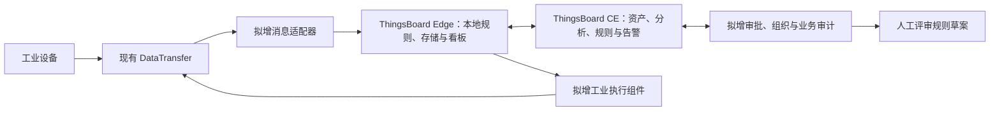

本次对照于 2026 年 9 月 19 日开始、9 月 20 日完成，以工作区内的 SmartFactory 代码、需求文档，以及本次从 GitHub 获取的 ThingsBoard CE v4.3.1.5 源码为依据。

**基于 ThingsBoard 继续开发，可以省去设备与资产管理、遥测存储、规则编辑与执行、看板、告警通知等通用平台的重复建设。** SmartFactory 现有方案中，仍需要自行开发的内容主要是工厂控制审批、边缘执行前的条件核验、企业组织权限、可校验审计，以及信创适配。采用这个方向后，原先按六个业务微服务分别建设平台的方式，以及云端全程使用自定义消息信封的要求，都需要重新评估。

这里的改造路线属于本次分析建议；现有业务需求是否继续作为交付要求，仍以项目后续取舍为准。

| 本次核对对象 | 版本与位置 | 本次用途 |
|---|---|---|
| ThingsBoard CE | [v4.3.1.5 源码目录][tbroot]，提交 `2cd31ac359214f94b945546830da503ddf80070f`；[官方发布页][release]日期为 2026-09-11 | 主要实现依据；从官方仓库浅层获取发布标签，并建立独立工作目录 |
| 原有 ThingsBoard | [原有 CE 工作目录](/path/to/competition-workspace/upstream/thingsboard)，提交 `9abbcdb40ac0e0dc80de468a8d9825a4b81b2260`，2026-05-27 | 原有参考版本，工作目录仍停留在原提交 |
| 原有 ThingsBoard Edge | [原有 Edge 工作目录](/path/to/competition-workspace/upstream/thingsboard-edge)，提交 `bf842e378a067b98d30feaf7ece29e4560cb8b66`，2026-05-15 | 辅助参考；本次云边通信实现主要查看新版 CE 中的 Edge 服务，离线能力另核对官方文档 |
| 原有 IoT Gateway | [原有 Gateway 工作目录](/path/to/competition-workspace/upstream/thingsboard-gateway)，提交 `c1e7604aa276a3ed98fe3df6cb1241b93f4c6177`，2026-05-19 | 辅助核对采集网关、插件和本地缓冲的位置；未更新此仓库 |
| SmartFactory | [项目目录][sfroot]中的当前工作文件，包含原有未提交修改 | 以实际源码和基线判断现状 |

SmartFactory 当前仓库的应用代码集中在 [DataTransfer][dtreadme]。项目顶层还有 Baseline 和空的 APIContracts 目录，云端六服务的设想记录在[云端平台需求基线][platform]中，仓库尚未提供对应的云端服务与前端实现。因此，迁移工作的主要对象是边缘采集代码、消息契约与业务需求，暂时没有已运行的自研云平台需要整体搬迁。

DataTransfer 已有 Modbus、MQTT Device、gRPC/MQTT 北向通信、SQLite 缓冲、命令处理和配置更新等实现。OPC-UA 的 native `Subscribe` 当前只等待上下文结束；`BP_DEGRADE` 会回退到 `BP_BLOCK`，动态降低采集频率与性能目标仍列为待办。源码与[协作事项][dtstatus]在这些方面一致，具体实现分别见 [OPC-UA][opcua]、[背压策略][backpressure]。

本次在已有本地依赖缓存下运行了 `GOTOOLCHAIN=local GOPROXY=off GOSUMDB=off make test`。完整测试中，`TestAppSmokeStartsManagementAndGRPC` 在等待停机时超过 2 秒，其他有测试的包通过；定向执行该测试并使用 `-count=3` 后，再次出现同一超时。当前工具链为 Go 1.27.0，模块声明为 Go 1.25.0。这项结果需要在继续使用 DataTransfer 时处理，原因尚未定位。测试位置见[启动与停机测试][smoketest]。

两边思路与实现的对应关系如下。

| 关注点 | SmartFactory 当前要求 | ThingsBoard 的具体实现 | 转向后的处理方式 |
|---|---|---|---|
| 平台组织方式 | 数据网关、数据处理、编排控制、审计、资产、身份权限六服务，另设配置中心 | Java 17、Spring Boot、Angular；核心业务共享实体和服务体系，Transport、Core、Rule Engine 等可按运行职责部署；内部使用队列与 Actor。[构建声明][pom]、[规则消费服务][consumer] | 以现有平台运行结构承载业务，在必要位置扩展；原六服务划分可转为功能责任划分 |
| 设备与资产 | 物理设备与车间、产线等逻辑资产分开，资产支持层级和标签，云端管理、边缘可提审 | `Device`、`Asset`、实体关系、属性均有现成模型；设备和资产也有 `version` 字段。[设备][device]、[资产][asset] | 直接使用实体体系；补充标签规范、边缘资产变更申请与审批，并定义原 `entity_revision` 的映射 |
| 规则编辑与执行 | 蓝图式可视化、标准规则对象、自定义脚本、持久化 | 前端编辑 `RuleChainMetaData` 的节点及连接；节点配置为 JSON，Java `TbNode` 执行，支持 CORE/EDGE 规则链。[规则图][rulemeta]、[节点接口][tbnode]、[规则编辑器][editor] | 复用编辑器与引擎，为工厂业务增加节点；当前连线表示消息分支，业务数据类型检查需要另加 |
| 分析、聚合与告警 | 资产级指标、自定义分析、可视化告警对象、邮件和短信 | 本版 CE 已有 Calculated Fields，涵盖脚本、传播、关联实体聚合、时序聚合及告警类型；还有通知渠道实现。[计算类型][cftype]、[计算执行][cfprocessing]、[通知渠道][channels] | 先用现成计算字段和规则链表达工厂指标，只有超出它们能力的算法才另写服务 |
| 云边自治 | 云端生成规则策略，边缘缓存、研判并在断网期间执行 | ThingsBoard Edge 提供本地规则引擎、数据存储和云边同步；云端源码中有 Edge 会话、事件批次、重发和确认逻辑。[Edge 会话][edgesession]、[官方离线执行说明][edgedocs] | 以匹配版本的 Edge 承担本地平台能力，补充工业执行条件核验；具体版本组合与资源需求需要部署验证 |
| 设备协议采集 | Go DataTransfer，内置 Connector、自定义信封、进程插件契约 | IoT Gateway 负责工业协议转换、Connector、Converter 与本地缓冲；它与 Edge 分工不同。[官方 Gateway 文档][gatewaydocs]、[本地 Gateway 存储实现][gatewaystorage] | DataTransfer 与 IoT Gateway 都可承担采集层；前者保留已有定制，后者提供较多现成协议，按首批设备选取 |
| 消息与接入协议 | `DeviceMessage`/`DeviceMessageBatch`、`dt/v1/...` 主题，云端校验后透传 | Gateway API 使用 `v1/gateway/...`；有 JSON/Protobuf 适配，但按 ThingsBoard 自己的 schema 解析，再生成包含实体、元数据、正文的 `TbMsg`。[主题处理][mqttdispatch]、[消息转换][transport]、[内部消息][tbmsg] | 增加适配器；边缘内部继续使用原信封，进入 TB 时转换成设备、属性、遥测和业务事件 |
| 下行控制 | 云端调用预案，边缘生成 `command_id`；风险研判、会签、上级审批、现场确认 | RPC 节点处理 `method`、`params`、请求标识、过期时间、重试和是否持久化，再路由到设备。[RPC 节点][rpcnode] | 复用调用与回执通道，另建审批状态和边缘执行组件；过期控制的拒绝、重复调用处置需在执行组件落实 |
| 企业组织与权限 | 人事组织树、团队与规则组权限、上下级审批、现场角色 | CE 基于系统管理员、租户管理员、客户用户等 Authority 及权限检查器；Group Role 是 PE 的实体组授权机制。[CE 权限检查][permissions]、[PE Group Role][grouprole] | CE 路线需补充组织和授权，PE 可提供更完整的基础权限；工业会签与现场确认流程仍需定制 |
| 审计 | 云边统一事件、关联消息与配置、永久只追加、可校验、完整责任链 | `AuditLog` 记录实体、用户、动作、数据和结果；标准表未定义前序摘要或签名字段，并有可配置的 TTL 清理服务。[审计表][auditschema]、[清理条件][auditttl] | 保留平台操作日志，另建需要永久保存的业务审计记录与校验机制，统一关联云边请求 |
| 外部系统插件 | 人事/MES/ERP 导入、插件进程隔离、凭据库、模型映射 | Platform Integrations 属于 PE；CE 有设备 API、REST API、规则节点等扩展入口。[官方接入方式][integrationdocs]、[REST 节点][restnode] | CE 下可把外部同步做成独立服务，通过平台 API 导入；组织树及增量同步语义仍自行定义 |
| AI/MCP | 数据和告警分析、规则草案，人工评审激活 | 官方另有 `thingsboard-mcp`，提供查询，也包含实体增删、遥测写入和 OTA 分配等工具，可按工具组开关。[官方 MCP 项目][mcp] | 可以复用查询工具；按本项目需求限定实际可调用操作，并增加规则草案、差异预览与人工发布流程 |
| 数据库与加密 | 达梦等指定数据库、国密、边缘 mTLS 与节点准入 | 默认关系存储使用 PostgreSQL；SQL 含 `jsonb`、分区、`ON CONFLICT`、序列等。Edge TLS 为可选，连接认证使用 routing key/secret。[数据库配置][dbconfig]、[关系写入 SQL][relationsql]、[Edge TLS][edgetls] | 单独验证指定数据库和加密环境；这部分会影响 DAO、建表、升级及云边通信，不能只按驱动配置估算工作量 |

有几处差异会直接决定能省去多少工作。

**“每个客户独立部署”可以继续采用，但 ThingsBoard 内部的租户模型适合保留。** 现有网关基线 FR-GW-101 同时要求单租户部署和数据模型不含租户字段，而 ThingsBoard 的设备、资产、规则链、权限与查询都使用 `tenantId`。采用“一套实例只使用一个业务租户”的方式，就能维持客户实例隔离；删除模型中的租户字段则会扩大修改范围，后续升级也要持续处理这些差异。依据见[网关基线][gatewaybaseline]、[设备模型][device]、[规则链模型][rulechain]。

消息适配也需要在计划中明确安排。当前 DataTransfer 的 MQTT 发布端序列化的是 `DeviceMessageBatch`，接收的下行主题只有自定义 command/config 等内容；ThingsBoard 的 Gateway 处理器则按自己的固定主题和信封结构分派。直接替换 Broker 地址后，消息无法进入预期的 ThingsBoard 数据通路。两端的实际代码见[DataTransfer 主题][dttopics]、[批次序列化][dtpublish]与[TB Gateway 分派][mqttdispatch]。

以下是保留 DataTransfer 时可以采用的映射草案，尚未实现。

| 原契约 | 在 ThingsBoard 一侧的拟议表达 | 需要保留的语义 |
|---|---|---|
| `device.device_id` | 外部设备 ID 与 TB Device UUID 的持久映射 | 显示名称变化时，设备身份仍能正确对应 |
| `device.tags` | 设备属性与 Asset/Device 关系 | 工厂、车间、产线等标签含义由项目约定 |
| `telemetry.datapoints` | 对应设备的键值遥测，按采样时间分组 | 每个测点自己的时间戳；乱序和补发处理 |
| `quality`、`unit` | 在设备模型、属性或额外遥测字段中约定表示方法 | 数据质量与单位必须有明确去向 |
| `STATUS` | 连通状态、设备属性或业务状态遥测 | 设备连通性与设备业务状态分别建模 |
| `EVENT` | 自定义业务事件及审计通路；需要告警时再创建 Alarm | 事件 ID、严重性、上下文及持久确认要求 |
| `CMD_RESPONSE` | RPC 回执与业务执行结果记录 | 区分 TB 请求 ID、云端 `downlink_id` 和边缘 `command_id` |
| `message_id` | 消息元数据和业务去重记录中的原始 ID | 同一消息重传时继续使用原 ID；TB 内部新消息 UUID 有独立用途 |
| `entity_revision` | 配置同步组件中的明确版本映射 | 定义版本的产生者、持久保存和乱序拒绝规则 |

可靠投递需要按两端的完成条件重新验证。DataTransfer 当前在 Paho `Publish` 的 token 成功后，将 SQLite 缓冲记录标记为 completed；如果中间经过通用 Broker，完成条件就在 Broker 这一跳。ThingsBoard Gateway 的 MQTT PUBACK 则由 Transport 成功回调触发，所查遥测路径的回调来自规则队列生产成功；后续存储由规则链继续执行。项目基线要求的“事件已持久保存并完成业务去重后才确认”，需要由对应业务处理器给出确认，并结合实际队列后端验证。依据见 [DataTransfer 缓冲完成][dtcomplete]、[TB MQTT 回调][tback]、[规则队列发送][tbqueue]。

下行有同样的契约问题：ThingsBoard 提供持久 RPC 和过期时间，SmartFactory 要求紧急控制超时或离线后快速失败。适配时需明确哪些操作允许排队、何时算送达、何时算执行完成。现有 DataTransfer 的 `command_id` 去重记录存于内存 map；如交付要求包括进程重启后的重复执行保护，需要增加持久记录或设备侧幂等处理。源码见[命令记录][commandrecords]。

工业控制流程可以建立在已有规则和 RPC 通道之上：云端保存预案、提交审批并发送调用请求；边缘执行组件检查有效期、审批凭据及本地条件，随后生成 `command_id` 并调用 DataTransfer。拒绝原因、风险分类、现场确认和执行结果进入业务审计。执行检查应覆盖所有能抵达设备的控制入口，避免管理界面、API 和规则节点采用不同的执行条件。这些工作对应云端基线 FR-OC-030～034，而目前查询到的 RPC 实现提供的是消息路由和回执机制。

图中展示保留 DataTransfer、采用 ThingsBoard Edge 的候选结构；适配器、工业执行组件与审批审计扩展是拟开发部分。

如果首批设备能由 IoT Gateway 的现成 Connector 满足，采集层也可以使用 IoT Gateway；这会减少自研采集服务的维护工作。若要继续利用已有 Go 代码和消息契约，则可以保留 DataTransfer，先增加适配器。采用 Edge 是为了复用本地规则和断网执行；只需要采集上报的场景，可以把采集端直接连接云端平台。Edge 自身的数据库、进程资源和云边版本组合，都需根据实际边缘机器验证。[官方 Edge 定位][edgewhy]与[Gateway 文档][gatewaydocs]说明了两者的职责。

达梦与国密要求需要在安排迁移工作时优先核实。源码已经显示 PostgreSQL 特有的数据类型、查询与分区用法，Edge 的 TLS 初始化也只建立了服务端证书配置，未在该处设置客户端证书强制认证；启用普通 TLS 后，原方案的 mTLS 和国密要求仍需要专门实现。如果最终验收指定全部数据必须进入达梦，就应先完成指定版本数据库的建表、实体读写、时序读写和升级脚本验证，再估算整体迁移工作量。若允许通用平台使用 PostgreSQL、业务扩展使用指定数据库，则可以采用分开的存储职责；是否允许这种部署方式，需要项目验收条件明确。

按当前时间约束推进时，可以采用以下顺序。

1. 先确定本轮交付必须保留的业务要求，明确 CE/PE、边缘断网执行、指定数据库和加密环境。把原六服务规划中的可复用功能映射到 ThingsBoard，同时标明审批、审计和组织权限的新增范围。
2. 在固定发布版本上完成一条遥测流程：模拟设备或已有 Modbus 设备 → 采集层 → ThingsBoard → 历史曲线、资产指标与告警。保留 DataTransfer 时，这一步同时实现身份映射、时间戳和消息格式转换。
3. 完成一条低风险测试控制流程：云端请求 → 边缘条件核验 → 设备执行 → 回执与记录，并覆盖超时、断网、重复请求和进程重启。通过这些用例确定消息确认与执行完成的含义。
4. 根据实际需要加入 Edge 本地规则执行及恢复同步，再扩展组织授权、工业审批和可校验审计。新节点应通过 `TbNode` 和独立服务扩展，平台修改集中在经过确认的入口，便于后续合并上游升级。
5. 最后把项目差异整理为可复现的演示：相同设备与负载下比较采集、控制、断网恢复和资源使用，展示审批及审计流程。现有 500 设备、5000 msg/s、下行 200ms、内存 256MB 都是待验证目标，应在同一测试条件下取得结果后再用于“优化”的结论。

本次完成的是源码获取、实现对照和现有 DataTransfer 测试核验。ThingsBoard、Edge 与 DataTransfer 的联合部署、数据库兼容性及性能测试尚待上述验证流程完成。

[tbroot]: /path/to/competition-workspace/upstream/thingsboard-v4.3.1.5
[sfroot]: /path/to/SmartFactory-2026
[release]: https://github.com/thingsboard/thingsboard/releases/tag/v4.3.1.5
[dtreadme]: /path/to/SmartFactory-2026/DataTransfer/README.md
[platform]: /path/to/SmartFactory-2026/Baseline/Platform/智慧工厂云端平台需求基线.md:59
[gatewaybaseline]: /path/to/SmartFactory-2026/Baseline/Platform/DataGateway/平台数据网关需求基线.md:52
[dtstatus]: /path/to/SmartFactory-2026/DataTransfer/docs/协作事项.md:45
[opcua]: /path/to/SmartFactory-2026/DataTransfer/internal/connector/opcua/connector.go:414
[backpressure]: /path/to/SmartFactory-2026/DataTransfer/internal/connector/manager.go:124
[smoketest]: /path/to/SmartFactory-2026/DataTransfer/internal/bootstrap/app_test.go:19
[pom]: /path/to/competition-workspace/upstream/thingsboard-v4.3.1.5/pom.xml:28
[consumer]: /path/to/competition-workspace/upstream/thingsboard-v4.3.1.5/application/src/main/java/org/thingsboard/server/service/queue/DefaultTbRuleEngineConsumerService.java:52
[device]: /path/to/competition-workspace/upstream/thingsboard-v4.3.1.5/common/data/src/main/java/org/thingsboard/server/common/data/Device.java:32
[asset]: /path/to/competition-workspace/upstream/thingsboard-v4.3.1.5/common/data/src/main/java/org/thingsboard/server/common/data/asset/Asset.java:29
[rulechain]: /path/to/competition-workspace/upstream/thingsboard-v4.3.1.5/common/data/src/main/java/org/thingsboard/server/common/data/rule/RuleChain.java:27
[rulemeta]: /path/to/competition-workspace/upstream/thingsboard-v4.3.1.5/common/data/src/main/java/org/thingsboard/server/common/data/rule/RuleChainMetaData.java:24
[tbnode]: /path/to/competition-workspace/upstream/thingsboard-v4.3.1.5/rule-engine/rule-engine-api/src/main/java/org/thingsboard/rule/engine/api/TbNode.java:17
[editor]: /path/to/competition-workspace/upstream/thingsboard-v4.3.1.5/ui-ngx/src/app/modules/home/pages/rulechain/rulechain-page.component.ts:98
[cftype]: /path/to/competition-workspace/upstream/thingsboard-v4.3.1.5/common/data/src/main/java/org/thingsboard/server/common/data/cf/CalculatedFieldType.java:11
[cfprocessing]: /path/to/competition-workspace/upstream/thingsboard-v4.3.1.5/application/src/main/java/org/thingsboard/server/service/cf/AbstractCalculatedFieldProcessingService.java:122
[channels]: /path/to/competition-workspace/upstream/thingsboard-v4.3.1.5/application/src/main/java/org/thingsboard/server/service/notification/channels
[edgesession]: /path/to/competition-workspace/upstream/thingsboard-v4.3.1.5/application/src/main/java/org/thingsboard/server/service/edge/rpc/EdgeGrpcSession.java:420
[edgedocs]: https://thingsboard.io/docs/edge/key-concepts/data-processing/
[edgewhy]: https://thingsboard.io/docs/edge/why-thingsboard-edge/
[gatewaydocs]: https://thingsboard.io/docs/iot-gateway/
[gatewaystorage]: /path/to/competition-workspace/upstream/thingsboard-gateway/thingsboard_gateway/storage/sqlite/sqlite_event_storage.py:31
[mqttdispatch]: /path/to/competition-workspace/upstream/thingsboard-v4.3.1.5/common/transport/mqtt/src/main/java/org/thingsboard/server/transport/mqtt/MqttTransportHandler.java:418
[transport]: /path/to/competition-workspace/upstream/thingsboard-v4.3.1.5/common/transport/transport-api/src/main/java/org/thingsboard/server/common/transport/service/DefaultTransportService.java:528
[tbmsg]: /path/to/competition-workspace/upstream/thingsboard-v4.3.1.5/common/message/src/main/java/org/thingsboard/server/common/msg/TbMsg.java:39
[rpcnode]: /path/to/competition-workspace/upstream/thingsboard-v4.3.1.5/rule-engine/rule-engine-components/src/main/java/org/thingsboard/rule/engine/rpc/TbSendRPCRequestNode.java:63
[permissions]: /path/to/competition-workspace/upstream/thingsboard-v4.3.1.5/application/src/main/java/org/thingsboard/server/service/security/permission/DefaultAccessControlService.java:26
[grouprole]: https://thingsboard.io/docs/pe/user-guide/roles/#group-role
[auditschema]: /path/to/competition-workspace/upstream/thingsboard-v4.3.1.5/dao/src/main/resources/sql/schema-entities.sql:67
[auditttl]: /path/to/competition-workspace/upstream/thingsboard-v4.3.1.5/application/src/main/java/org/thingsboard/server/service/ttl/AuditLogsCleanUpService.java:21
[integrationdocs]: https://thingsboard.io/docs/connect-iot-devices/
[restnode]: /path/to/competition-workspace/upstream/thingsboard-v4.3.1.5/rule-engine/rule-engine-components/src/main/java/org/thingsboard/rule/engine/rest/TbRestApiCallNode.java
[mcp]: https://github.com/thingsboard/thingsboard-mcp
[dbconfig]: /path/to/competition-workspace/upstream/thingsboard-v4.3.1.5/application/src/main/resources/thingsboard.yml:954
[relationsql]: /path/to/competition-workspace/upstream/thingsboard-v4.3.1.5/dao/src/main/java/org/thingsboard/server/dao/sql/relation/SqlRelationInsertRepository.java:33
[edgetls]: /path/to/competition-workspace/upstream/thingsboard-v4.3.1.5/application/src/main/java/org/thingsboard/server/service/edge/rpc/EdgeGrpcService.java:215
[dttopics]: /path/to/SmartFactory-2026/DataTransfer/internal/northbound/mqtt/topics.go:13
[dtpublish]: /path/to/SmartFactory-2026/DataTransfer/internal/northbound/mqtt/adapter.go:359
[dtcomplete]: /path/to/SmartFactory-2026/DataTransfer/internal/northbound/mqtt/adapter.go:157
[tback]: /path/to/competition-workspace/upstream/thingsboard-v4.3.1.5/common/transport/mqtt/src/main/java/org/thingsboard/server/transport/mqtt/session/AbstractGatewaySessionHandler.java:812
[tbqueue]: /path/to/competition-workspace/upstream/thingsboard-v4.3.1.5/common/transport/transport-api/src/main/java/org/thingsboard/server/common/transport/service/DefaultTransportService.java:1113
[commandrecords]: /path/to/SmartFactory-2026/DataTransfer/internal/command/service.go:90
