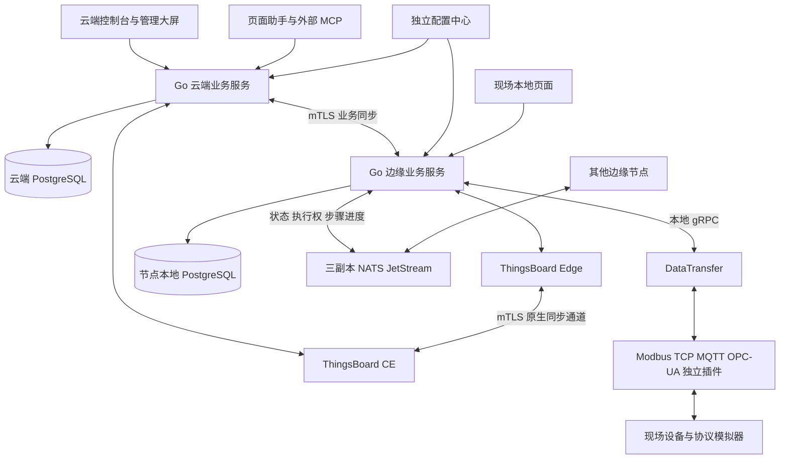

# 系统设计

## 服务和存储职责

每个客户使用独立平台实例和一个业务租户。云端 ThingsBoard CE 保存原生实体、遥测投影、规则链、计算字段和告警；Go 业务服务负责组织权限、编排版本、修订、控制会签、审计、AI/MCP 和三套前端 API。独立配置中心保存程序参数的 Schema、版本、生效记录与加密凭据。

边缘节点运行 DataTransfer、Go 边缘服务、ThingsBoard Edge 和本地数据库。DataTransfer 使用 Modbus TCP、MQTT 3.1.1/5.0、OPC-UA 或独立进程插件采集设备；业务桥通过 gRPC 批量保存观测。跨节点预案通过三个 NATS JetStream 副本交换所需状态，设备命令始终由所属节点执行。

| 模块 | 源码 | 状态归属 |
|---|---|---|
| 采集、转换、命令与持久队列 | `DataTransfer/internal` | 节点本地 SQLite 日志与缓冲 |
| 业务数据与归档 | `Platform/internal/store` | PostgreSQL；SQLite 用于开发与小规模恢复检查 |
| 分析、告警、策略执行 | `Platform/internal/engine` | 定义版本、运行状态、派生观测和修订 |
| 人员与资源权限 | `Platform/internal/identity` | 用户、组织、团队授权与签名离线包 |
| 控制会签与现场执行 | `Platform/internal/control` | 执行对象、审批、步骤日志和风险快照 |
| 现场协调 | `Platform/internal/coordination` | 三副本执行权、状态、进度；本地动作日志 |
| 云边同步 | `Platform/internal/cloudsync` | 提交游标、发件箱、原始来源和准入信息 |
| 原生平台适配 | `Platform/internal/thingsboard` | 业务 ID 到 TB ID 的持久映射 |
| 页面、AI 与 MCP | `Frontends`、`Platform/internal/ai` | 页面配置、目录查询和草稿 |

## 数据路径

设备消息沿用 `message_id`、`command_id`、`entity_revision` 与 snake_case 字段。桥接层保留来源序号、原始值、协议质量、质量原因、设备时间或采集时间，以及设备和资产版本；同一批多条消息在一次事务中保存观测、去重信息和后续任务。

普通持续读数采用接收确认。队列按照配置阻塞、降频或删除最旧持续数据；删除时保存按设备、字段、时间范围和原因汇总的缺口。事件、命令回执、配置和规则采用提交后的业务确认，发送方在确认前保留原始 ID 和内容摘要。相同 ID 的不同内容返回冲突，数据库写入失败时不会返回成功业务确认。

业务服务保存完整观测后，向 ThingsBoard 投递遥测与原生质量字段，并通过原生规则链回调执行类型化定义。实时策略使用独立持久队列和执行锁，分析与历史补算使用计算队列；原生服务不可达时，投递任务递增等待，现场策略继续处理当前观测。分析引擎保存派生结果，随后将结果投影到 ThingsBoard；已有原生滚动计算能力用于适用的数值窗口。原始精度整数由业务存储保留，超出 TB 有符号整数范围的投影使用文本表达。

云边同步与现场共享保留观测原始身份，避免相同数据沿多条路径被重复累计。同步游标仅在变化时保存，在线状态按心跳周期持久化。读数去重记录按重投范围到期清理；业务事件保留身份与摘要，已确认发送正文按策略清理。

## 分析与历史修订

分析、告警与策略共用 `Definition`、类型化端口、连接、参数、输出和依赖；节点的允许范围由定义种类决定。发布前进行依赖与类型检查，草稿可使用样本模拟，正式版本保存生效时间。精确整数和有理数运算用于需要严格数值一致性的表达式，脚本受执行时间与资源额度限制，错误通过明确分支处理。

大屏在趋势查询中同时请求最新值，指标卡片展示各系列的最新观测，时间窗口控制历史曲线。图表复用已有实例，布尔状态以阶梯线和开关坐标显示。

默认仅 GOOD 数据参与业务计算。BAD 与 UNCERTAIN 的原始记录继续保存，查询返回质量统计、来源状态、缺口、完整程度、补传状态和修订。计数以稳定事件身份去重，同一时间发生的不同事件分别保留。

补传在可用原始数据范围内创建补算任务，按相应历史时间的规则和资产版本执行。补算处理分析与告警，保存旧值、新值、影响范围和原因；控制由实时路径和边缘调度触发。超过自动补算范围的资料进入人工检查流程。

原始与派生精度数据默认保留 30 天，分钟、小时、日汇总分别保留 90 天、1 年、3 年。最近 24 小时保持热数据，较早观测使用按系列分块的列式 JSON 与 gzip 归档；所有字段、数值、版本与时间信息均可恢复。归档经过校验后，在同一数据库事务中保存块并删除对应热记录；热数据和归档由同一查询入口合并，派生修订选择最新有效版本。

## 控制和现场协调

普通即时控制需要一名工程师与一名领导，业务强制执行需要两名工程师与一名领导；安全强制执行还要求指定现场安全员使用本地会话和二次认证确认。会签绑定预案版本、参数及风险依据，组织变动、人员撤销、参数变化和审批到期会影响下发资格。控制开始后，在每个设备步骤前再次检查本地联锁。

下发请求使用 `downlink_id`，步骤使用由执行和步骤共同确定的 `command_id`。步骤在发送前写入本地动作日志，完成后保存回执；进程在发送结果不明时退出，会留下待核对结果。已完成动作在重复请求和恢复时返回保存的结果。

跨节点预案启用前核对参与节点的定义版本与内容摘要。执行权通过三副本多数确认和递增版本取得，执行节点在物理动作前校验该版本及有效期。协调者保存每个步骤的进度，其他参与节点可恢复过期执行权对应的任务；失去多数或参与节点状态过期时，执行预案配置的本地降级步骤。

## 安全与审计

云边业务连接使用 mTLS，证书与登记节点关联，停用和准入检查失败的节点无法建立有效连接。DataTransfer 跨主机 gRPC 连接同样要求 TLS。NATS 使用客户端证书、路由证书和独立访问凭据，消息包含来源签名，目标节点检查设备归属及已发布预案。

离线权限包包含签名、节点身份、版本和到期时间，凭据按登记边缘的密钥封装，默认有效期 48 小时。管理员在联网环境维护权限，新规则发布通过云端评审；本地入口使用已同步授权执行已有预案。

审计按来源维护序号、前项哈希、当前哈希和签名检查点，保存操作时的身份、会话、请求、版本和数据快照。校验检查内容修改、缺号、插入和顺序异常，控制追踪页面按照同一执行标识关联会签、判断、命令和回执。
